  

  
  
  

<table align="center">
  <tr>
    <td align="right"><b>把每一个想法，炼成可运行的系统</b></td>
    <td align="center">&nbsp;·&nbsp;</td>
    <td align="left"><b>「目标是进程，习惯是服务，成长是不断迭代的内核！」</b></td>
  </tr>
</table>

  
  

  
  
  
  
  
  
  
  
  
  
  

